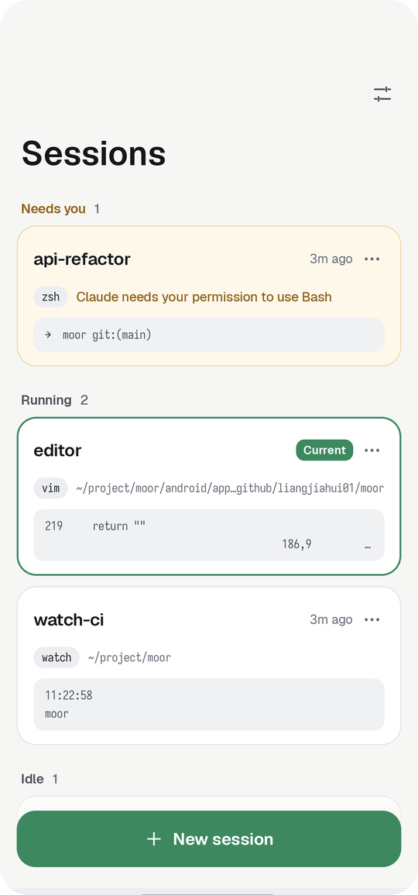
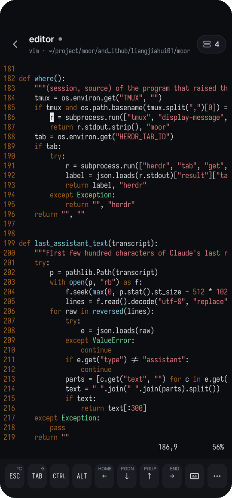
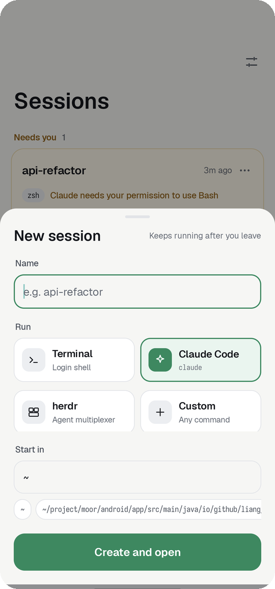
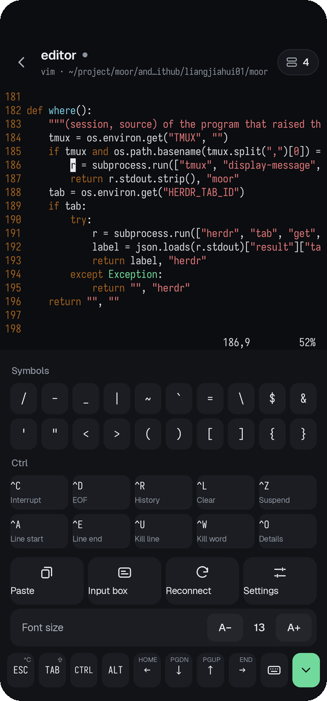
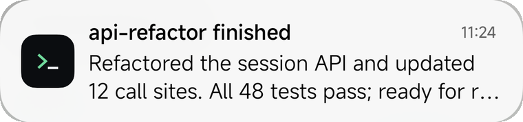

# Moor

手机上的终端，会话留在你自己的机器上。

Moor 通过 SSH 连到你的机器，每个会话都在那台机器上持续运行，手机上随时切换。关掉应用、断网、隔天再打开，会话都还在跑。Claude Code 等你输入或者跑完任务时，手机收到通知。

[English](README.md)

<p align="center">
  
  
  
  
</p>

## 功能

| | |
|---|---|
| 持久会话 | 主机上一个很小的会话守护进程持有每个会话的终端、屏幕和最近 5,000 行历史；重新接入时屏幕原样恢复，翻看历史直接在手机上滑。新建时起名，选运行什么（shell、Claude Code、herdr 或任意命令）和起始目录。 |
| 会话列表 | 按「需要你处理」「运行中」「空闲」分组，带最后几行输出的预览。 |
| 多台机器 | 可以添加多台机器，在会话列表顶部切换；每台记住自己的上次会话。 |
| 通知 | Claude Code 等你输入、任务完成（带它最后一句回复），可选任意程序的终端响铃。 |
| 扫码配对 | 主机上运行 `moor pair`，手机扫码，连接信息和公钥一步配好。要加一台平板或另一台手机，在已配好的设备上点「设置 → 配置另一台设备」：第 1 步的码用新设备的相机扫，从 GitHub 下载 Moor；第 2 步的码在 Moor 里扫，所有机器和设置一起带过去，新设备登记自己的密钥。 |
| 语音输入 | 点输入框旁的话筒说话，文字边说边出现在输入框里，改好再发送，不用弹出键盘。用火山引擎豆包流式语音识别，填你自己的密钥。 |
| 图片 | 把照片或截图发进会话（相册、拍照，或从别的 App 分享）。图片传到主机，路径填进输入，Claude Code 会当作图片读取。 |
| 为手机设计的输入 | 底部两行：一行左右滑动的按键（Paste、Esc、Tab、Enter、Shift+Tab、方向键、Ctrl、Alt……），一行输入框，用平常的键盘打字或语音输入一整句，再发送。面板里有符号和 Ctrl 组合；键盘键直接往终端里打字。顶栏默认隐藏（可在面板里打开），第一个键打开会话列表。 |
| 浅色和深色 | 跟随系统，或手动选。 |
| Ghostty 外观 | Catppuccin Mocha / Latte 配色、JetBrains Mono 字体（带符号与 Nerd Font 图标）、竖线光标；中文在两格里居中。 |

## 要求

- Android 8.0 及以上。
- 一台能 SSH 登录的主机（Linux 或 macOS），装有 `python3`。不用另装别的，应用连上时会把辅助脚本拷过去。
- 手机要能连到主机的 SSH 端口（同一局域网、VPN、公网地址或转发端口），或者经一个小中继走[直连](#不在主机所在网络时)。

## 开始使用

1. 从 [Releases](https://github.com/liangjiahui01/moor/releases) 下载安装 APK。应用每天去那里查一次新版本，有就提示；设置 → 检查更新可以立即查。
2. 在主机上安装辅助脚本：

   ```sh
   mkdir -p ~/.local/bin
   curl -fsSL https://raw.githubusercontent.com/liangjiahui01/moor/main/server/moor -o ~/.local/bin/moor
   chmod +x ~/.local/bin/moor
   ```

3. 运行 `moor pair`，在应用里「设置 → 扫码配对」。也可以复制它打印的链接，用「粘贴链接」。

   ```sh
   moor pair                       # 主机地址取第一个 IPv4，端口 22
   moor pair --host my-box.lan --cmd claude --name my-box
   ```

以后要加别的机器，在那台机器上运行 `moor pair`，再点会话列表顶部的「添加机器」。扫已有机器的码会更新它。

想手动配置：在设置里填主机、端口、用户名，再把手机公钥加到主机的 `~/.ssh/authorized_keys`（设置 → 复制添加命令）。

## 不在主机所在网络时

主机在 NAT 后面（公司或云上的内网）、手机在别处时，Moor 可以用 WebRTC 让两边直接连通。你在一台公网服务器上跑一个小中继，它只在每次连接时帮两边交换地址；连上后 SSH 在手机和主机之间点对点传输，中继看不到内容。

1. 公网服务器上运行 `moor-rtc relay --listen :80`。
2. 主机上运行 `moor-rtc init --signal ws://中继地址/ws`，再常驻运行 `moor-rtc host`。
3. 重新 `moor pair` 配对。

完整步骤（systemd 服务写法、打不通直连时的备用隧道、安全说明、怎么看走的哪条路）见 [docs/remote-access.zh-CN.md](docs/remote-access.zh-CN.md)。

## 通知

<p align="center"></p>

| 事件 | 来源 | 默认 |
|---|---|---|
| 等你处理 | Claude Code 的 `Notification` 钩子 | 开 |
| 任务完成 | Claude Code 的 `Stop` 钩子，带最后一句回复 | 开 |
| 终端响铃 | Moor 会话里任意程序响铃 | 关 |

在设置里打开 Claude Code 钩子，或在主机上运行：

```sh
moor hooks install     # 在 ~/.claude/settings.json 加两个钩子，保留已有钩子，并备份原文件
moor hooks status
moor hooks uninstall
```

钩子在 Claude Code 运行的任何地方都会触发，不限于 Moor 会话；herdr 里的事件用 herdr 的 tab 名标注。任一通知打开时，应用在后台保持连接（常驻通知显示连接状态）。

点通知直接打开对应会话。你正在看的会话不会再弹通知。

## 工作方式

```
手机（Moor）                          主机
────────────                         ────
SSH 连接 ─────── 接入 ─────────────▶ moor attach ──▶ 会话守护进程（持有每个会话的终端）
         ─────── 列出/新建 ────────▶ 经执行通道跑 moor ls / new / kill
         ─────── moor watch ───────▶ ~/.local/state/moor/events.log
                                       ▲            ▲
                                       │            │
                       Claude Code 钩子       会话里的响铃
                       (moor notify claude)   （守护进程）       
```

- 一条 SSH 连到当前机器，承载接入的终端，以及列出、新建会话用的短执行通道；通知也只来自当前机器。
- 应用连上后把辅助脚本装到 `~/.local/share/moor/bin/moor`。辅助脚本按需启动会话守护进程。守护进程把每个会话的输出交给一个终端模拟器，接入时发送快照：历史、屏幕、光标和终端模式（全屏程序、鼠标、括号粘贴）。
- 辅助脚本更新后，运行中的守护进程会原地换上新代码，不中断任何会话。
- 图片存到主机的 `~/.cache/moor/uploads`，超过一周的文件自动清理。
- 配对：`moor pair` 往 `authorized_keys` 加一把临时密钥，带 `expiry-time`、`restrict` 和 `command=`，只能执行 `moor claim`。二维码里有主机地址、主机公钥和临时密钥的种子。手机用它登录一次，交出自己的公钥，临时密钥随即删除。主机公钥按二维码里的固定下来，不走首次连接信任。
- 配置另一台设备：已配好的设备用自己的密钥登录每台机器，运行 `moor invite`，加一把同样的临时密钥（在设备上生成）。二维码里是每台机器一条配对链接，加上应用设置，压缩后编码；新设备用自己的密钥逐条认领。不拷贝任何私钥。
- 私钥在手机上生成，不离开手机。
- 直连：应用为每条 SSH 连接运行一个 `moor-rtc dial`（打包在 APK 里），SSH 走它的标准输入输出。它经中继把 offer 发给 `moor-rtc host`，对方回 answer；两边用 ICE 找路径（公共 STUN 服务器，不用 TURN），打开一条数据通道，主机把通道接到本机 sshd。offer 和 answer 用配对链接里的共享密钥签名，密钥本身不在网络上传输。SSH 原样跑在通道里，仍然端到端加密、照常校验主机密钥；中继只看得到会话描述。

## 构建

```sh
cd android
./gradlew assembleDebug
```

可选的 `android/defaults.properties` 用来预填设置页：

```properties
host=my-box.lan
user=me
```

装有 Go（1.22 及以上）时，构建会把直连用的 `moor-rtc` 打进 APK；没有 Go 也能构建，只是不带直连。

存在 `android/keystore.properties`（`storeFile`、`storePassword`、`keyAlias`、`keyPassword`）时，release 包用它签名，否则用 debug 证书。

## 规划

- iOS 应用。

## 许可

Apache License 2.0。随附的第三方作品（含修改过的 Termux 终端模拟器）见 [LICENSE](LICENSE) 和 [NOTICE](NOTICE)。
